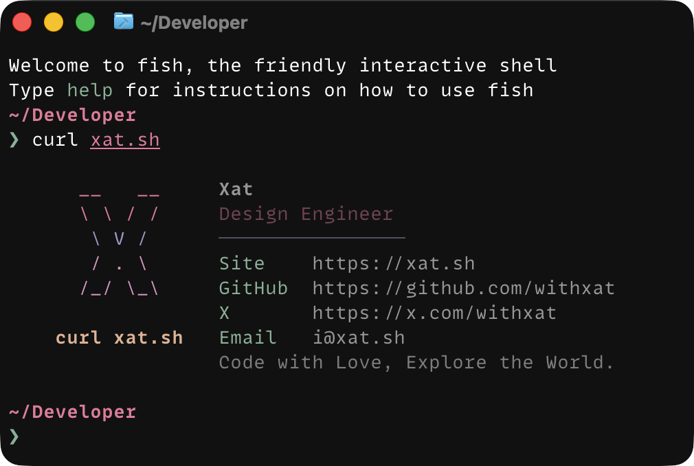

# Card

English · [简体中文](README.zh-CN.md)

A command-line business card for your domain.

```sh
curl xat.sh
```

<p>
  
</p>

Card is a Cloudflare Worker. Terminals get a neofetch-style card with ANSI colors;
browsers get your existing website, or a plain-text card if the domain has no
site yet. You describe the card in one file, [`card.config.ts`](card.config.ts).

## Get Your Own

[](https://deploy.workers.cloudflare.com/?url=https://github.com/withxat/card)

1. Click the button. Cloudflare copies this repository to your GitHub account and
   deploys it to a `*.workers.dev` address.
2. Edit `card.config.ts` in your copy and push. Cloudflare redeploys on every push.
3. Point your domain at it (below), then run `curl your-domain.com`.

Or by hand:

```sh
git clone https://github.com/withxat/card && cd card
pnpm install
pnpm run deploy
```

## Make It Yours

Everything on the card lives in [`card.config.ts`](card.config.ts):

```ts
export default defineCard({
	name: 'Xat',
	title: 'Design Engineer',
	logo: ['__   __', '\\ \\ / /', ' \\ V / ', ' / . \\ ', '/_/ \\_\\'],
	links: [
		{ label: 'Site', value: 'https://xat.sh' },
		{ label: 'Email', value: 'i@xat.sh' },
	],
	motto: 'Code with Love, Explore the World.',
	colors: { logo: ['cyan', 'blue', 'magenta'], label: 'green', command: 'yellow' },
})
```

- `curl <your domain>` is added under the logo automatically.
- Columns are aligned by terminal width, so Chinese, Japanese, and Korean text lines up.
- `logo` is any ASCII art; [`figlet`](http://www.figlet.org/) is an easy way to make one.
- Colors are the eight terminal colors, so the card follows each visitor's theme.

## Connect Your Domain

The domain must be a zone on Cloudflare.

**The domain has no website.** Add a custom domain to
[`wrangler.jsonc`](wrangler.jsonc); Cloudflare creates the DNS record. Browsers get
the plain-text card.

```jsonc
"routes": [{ "pattern": "example.com", "custom_domain": true }]
```

**The domain already has a website.** Route only the apex root to the Worker and
pass everything else through. The DNS record must be **Proxied**, or the Worker never
runs.

```jsonc
"routes": [{ "pattern": "example.com", "zone_name": "example.com" }],
"vars": { "BROWSER_HTTPS_REDIRECT": "true", "ORIGIN_PASSTHROUGH": "true" }
```

## Behavior

| Request                         | `ORIGIN_PASSTHROUGH: "false"` | `ORIGIN_PASSTHROUGH: "true"` |
| ------------------------------- | ----------------------------- | ---------------------------- |
| `curl example.com`              | Card                          | Card                         |
| `curl example.com/?plain`       | Card without colors           | Card without colors          |
| Browser, `http://example.com/`  | 301 to HTTPS                  | 301 to HTTPS                 |
| Browser, `https://example.com/` | Card without colors           | Your website                 |
| Any other path                  | 404                           | Your website                 |

Command-line clients are recognized by `User-Agent`: curl, wget, HTTPie, xh, aria2,
Python Requests, Go's HTTP client, and libwww-perl. On Windows, use `curl.exe`;
PowerShell's `curl` alias identifies itself as a browser.

## Gotchas

- **`curl example.com` prints nothing.** Cloudflare's **Always Use HTTPS** answers
  plain HTTP with a redirect before the Worker runs, and curl does not follow
  redirects. Turn it off; `BROWSER_HTTPS_REDIRECT: "true"` still sends browsers to
  HTTPS.
- **Browsers still see the old site.** Check that the DNS record is Proxied (orange
  cloud) and that the route pattern matches the domain exactly.

## Develop

```sh
pnpm install
pnpm dev                  # http://localhost:8787
curl localhost:8787       # in another terminal
```

| Command          | Description                            |
| ---------------- | -------------------------------------- |
| `pnpm dev`       | Run the Worker locally                 |
| `pnpm build`     | Bundle `src/index.ts` to `dist/` with tsdown |
| `pnpm test`      | Run tests                              |
| `pnpm typecheck` | Type-check                             |
| `pnpm lint`      | Lint                                   |
| `pnpm run deploy`| Build and deploy with Wrangler         |

xat.sh itself deploys with `pnpm run deploy --env xat`.

## Author

**Card** © [Xat](https://github.com/withxat), released under the
[MIT](LICENSE) License.<br>
Authored and maintained by Xat with help from contributors
([list](https://github.com/withxat/card/graphs/contributors)).

> [Blog](https://xat.sh) · GitHub [@withxat](https://github.com/withxat) ·
> Telegram [@withxat](https://t.me/withxat) · X
> [@withxat](https://x.com/withxat) · Email [i@xat.sh](mailto:i@xat.sh)
