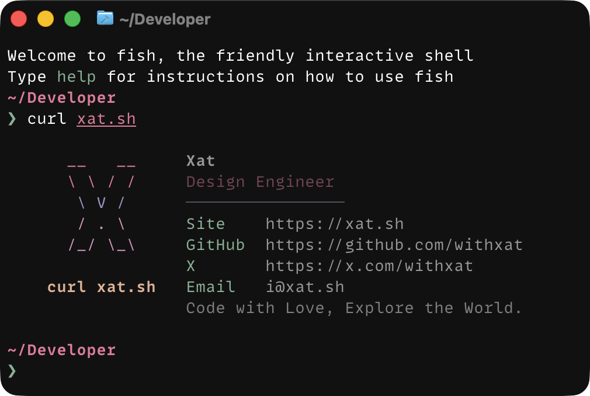

# Card

[English](README.md) · 简体中文

给你的域名一张命令行名片。

```sh
curl xat.sh
```

<p>
  
</p>

Card 是一个 Cloudflare Worker。终端访问时返回一张 neofetch 风格的彩色名片；浏览器访问时照常打开你原来的网站，域名还没有网站的话，就返回无颜色的纯文本名片。名片内容只写在一个文件里：[`card.config.ts`](card.config.ts)。

## 给自己也装一个

[](https://deploy.workers.cloudflare.com/?url=https://github.com/withxat/card)

1. 点上面的按钮。Cloudflare 会把这个仓库复制到你的 GitHub，并部署到一个 `*.workers.dev` 地址。
2. 在你的仓库里修改 `card.config.ts` 并推送，每次推送都会自动重新部署。
3. 按下文把域名接上，然后运行 `curl 你的域名`。

也可以手动部署：

```sh
git clone https://github.com/withxat/card && cd card
pnpm install
pnpm run deploy
```

## 改成你的名片

名片上的所有内容都在 [`card.config.ts`](card.config.ts) 里：

```ts
export default defineCard({
	name: '林小雨',
	title: '设计工程师',
	logo: [' _     ___ ', '| |   |_ _|', '| |__  | | ', '|____||___|'],
	links: [
		{ label: '博客', value: 'https://lin.dev' },
		{ label: '邮箱', value: 'hi@lin.dev' },
	],
	motto: '把每个像素都当作作品。',
	colors: { logo: ['magenta', 'red', 'yellow', 'green'], label: 'green', command: 'yellow' },
})
```

- Logo 下方会自动加上 `curl 你的域名`。
- 按终端显示宽度对齐，中文、日文、韩文占两格，不会错位。
- `logo` 可以是任意 ASCII 字符画，用 [`figlet`](http://www.figlet.org/) 生成最方便。
- 颜色只用终端的 8 种基础色，会跟随访问者的终端主题。

## 接入域名

域名需要已经托管在 Cloudflare 上。

**域名下还没有网站**：在 [`wrangler.jsonc`](wrangler.jsonc) 里加一个自定义域名，Cloudflare 会自动创建 DNS 记录。浏览器访问时会收到纯文本名片。

```jsonc
"routes": [{ "pattern": "example.com", "custom_domain": true }]
```

**域名下已经有网站**：只把根路径交给 Worker，其余请求照常转发到原站。DNS 记录必须是 **Proxied**（橙色云朵），否则 Worker 不会运行。

```jsonc
"routes": [{ "pattern": "example.com", "zone_name": "example.com" }],
"vars": { "BROWSER_HTTPS_REDIRECT": "true", "ORIGIN_PASSTHROUGH": "true" }
```

## 行为

| 请求                            | `ORIGIN_PASSTHROUGH: "false"` | `ORIGIN_PASSTHROUGH: "true"` |
| ------------------------------- | ----------------------------- | ---------------------------- |
| `curl example.com`              | 名片                          | 名片                         |
| `curl example.com/?plain`       | 无颜色的名片                  | 无颜色的名片                 |
| 浏览器访问 `http://example.com/`  | 301 跳转到 HTTPS              | 301 跳转到 HTTPS             |
| 浏览器访问 `https://example.com/` | 无颜色的名片                  | 你的网站                     |
| 其他路径                        | 404                           | 你的网站                     |

命令行客户端通过 `User-Agent` 识别：curl、wget、HTTPie、xh、aria2、Python Requests、Go 的 HTTP 客户端和 libwww-perl。Windows 上请用 `curl.exe`，因为 PowerShell 的 `curl` 别名会把自己标识成浏览器。

## 常见问题

- **`curl example.com` 没有输出**：Cloudflare 的 **Always Use HTTPS** 会在 Worker 运行之前就把 HTTP 请求重定向，而 curl 默认不跟随重定向。把它关掉就好，`BROWSER_HTTPS_REDIRECT: "true"` 仍然会把浏览器跳转到 HTTPS。
- **浏览器看到的还是原来的网站**：检查 DNS 记录是不是 Proxied，以及路由规则是否和域名完全一致。

## 本地开发

```sh
pnpm install
pnpm dev                  # http://localhost:8787
curl localhost:8787       # 另开一个终端
```

| 命令              | 说明                                  |
| ----------------- | ------------------------------------- |
| `pnpm dev`        | 本地运行 Worker                       |
| `pnpm build`      | 用 tsdown 把 `src/index.ts` 打包到 `dist/` |
| `pnpm test`       | 运行测试                              |
| `pnpm typecheck`  | 类型检查                              |
| `pnpm lint`       | 代码检查                              |
| `pnpm run deploy` | 构建并用 Wrangler 部署                |

xat.sh 本身用 `pnpm run deploy --env xat` 部署。

## 作者

**Card** © [Xat](https://github.com/withxat)，以 [MIT](LICENSE) 协议发布。<br>
由 Xat 编写和维护，感谢所有[贡献者](https://github.com/withxat/card/graphs/contributors)。

> [博客](https://xat.sh) · GitHub [@withxat](https://github.com/withxat) ·
> Telegram [@withxat](https://t.me/withxat) · X
> [@withxat](https://x.com/withxat) · Email [i@xat.sh](mailto:i@xat.sh)
